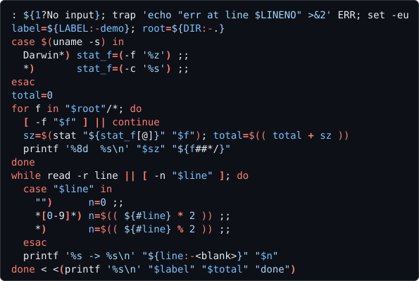
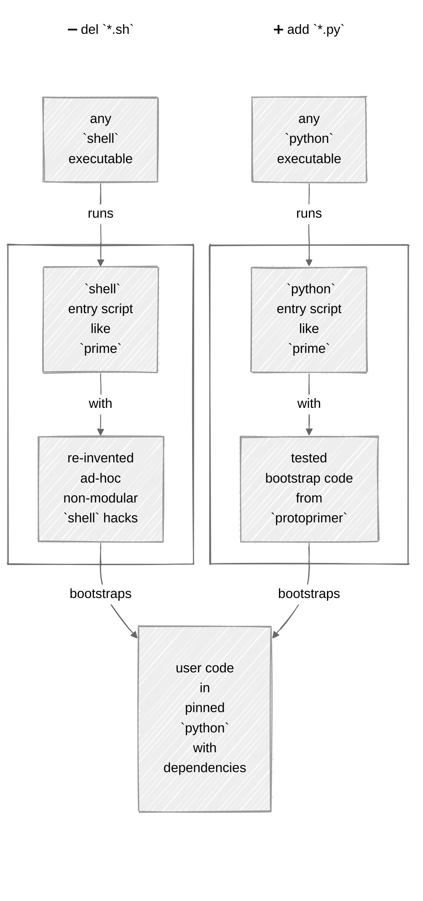
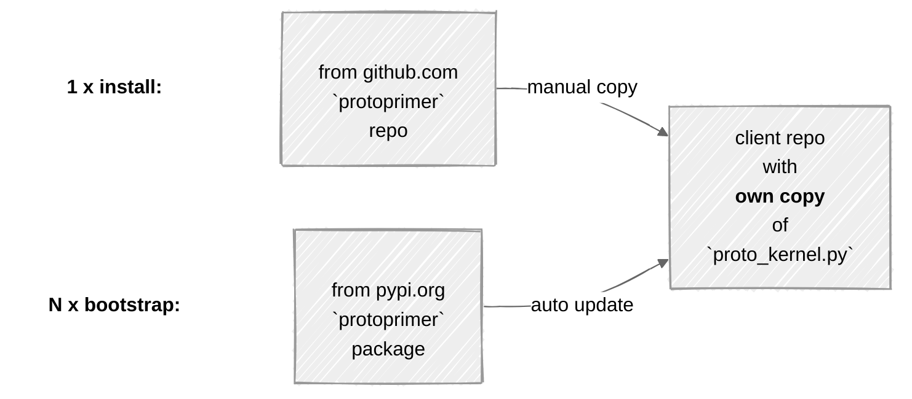

[](https://pypi.org/project/protoprimer)
[](https://github.com/uvsmtid/protoprimer/actions/workflows/test_py_min.yaml)
[](https://github.com/uvsmtid/protoprimer/actions/workflows/test_py_med.yaml)
[](https://github.com/uvsmtid/protoprimer/actions/workflows/test_py_max.yaml)
[](https://github.com/uvsmtid/protoprimer/actions/workflows/test_contract_compatibility.yaml)
[](https://github.com/uvsmtid/protoprimer/actions/workflows/lint.yaml)
[](https://github.com/uvsmtid/protoprimer/actions/workflows/doc.yaml)
[](https://coveralls.io/github/uvsmtid/protoprimer)
<!--
FT_84_11_73_28.supported_python_versions.md: see above.
-->

# `protoprimer`

... eliminates `shell` scripts **right off the bootstrap**:

<!-- NOTE: style="width: 11ch" ~ 11 chars = len("protoprimer"); snippet locked to height: 11ch so both track the same ch unit -->

# <code><a href="https://protoprimer.readthedocs.io/"></a></code> <code></code>

Want your users to run software **isolated** in a `git` repo after a single zero-argument command?

```sh
./prime
```

See the [Intro][protoprimer_readthedocs_intro] doc.

## TL;DR

`protoprimer` employs ubiquitous `python` for version pinning to provide a robust alternative to `shell`:

*   First, a **wild** `python` version found in `PATH` executes a shim that invokes `protoprimer`.
*   Last, `protoprimer` executes user code by the **required** `python` version from the configured `venv`.

Compare:

<!-- diagram:sh_vs_py:start -->

<!-- diagram:sh_vs_py:end -->

It works without `shebang` for `venv` to **avoid hardcoding** absolute paths and keep repo clones **relocatable**.

## Direct usage

*   Bootstrap (default env):

    ```
    ./prime
    ```

*   Bootstrap (special env):

    ```
    ./prime --env dst/special_env
    ```

*   Run some app **without** `venv` activation:

    ```
    ./some_app
    ```

<details>
<summary>and more...</summary>

*   From scratch: re-create venv, re-solve and re-install deps, re-pin versions:

    ```
    ./prime reset
    ```

*   Evaluate the effective config:

    ```
    ./prime eval
    ```

*   Start an interactive `shell` with an activated `venv`:

    ```
    ./prime shell
    ```

*   Run a function from a module in `venv`:

    ```
    ./prime start "some_module:some_func"
    ```

*   Run a function from a module in `venv` with some args:

    ```
    ./prime start "some_module:some_func" -- some args
    ```

</details>

<a id="protoprimer-quick-start"></a>

## Initial integration

See the [Tutorial][protoprimer_readthedocs_tutorial] doc.

You need to "seed" your repo with a copy of the [`proto_kernel.py`][local_proto_kernel.py] script:

<!-- diagram:proto_kernel_copy:start -->

<!-- diagram:proto_kernel_copy:end -->

*   Copy (one time):

    Commit your **own copy** next to `pyproject.toml`:

    ```
    ./
    ├── proto_kernel.py    <--- own copy
    ├── pyproject.toml
    └── *
    ```

    The location, name, and details can be changed through optional config.

<a id="protoprimer-first-examples"></a>

## First examples

### Baseline bootstrap script invoked via `boot_env`

This `entry_script` extends the bootstrap sequence via the [cmd_boot_env_example][cmd_boot_env_example] script:

```sh
./cmd/boot_env_example
```

<details>
<summary><code>proto_kernel.boot_env</code> <strong>triggers</strong> the bootstrap process before invoking a user function:</summary>

<br>

```py
# ./cmd/boot_env_example:
# ...
proto_kernel.boot_env(
    # module_name:function_name
    "local_doc.cmd_boot_env_example:custom_boot_env_main"
)
```

See [Boot env][protoprimer_readthedocs_tutorial_boot_env].

</details>

### Minimal application script invoked via `start_app`

This `entry_script` invokes the [cmd_start_app_example][cmd_start_app_example] script:

```sh
./cmd/start_app_example
```

<details>
<summary><code>proto_kernel.start_app</code> <strong>delegates</strong> execution to a user function:</summary>

<br>

```py
# ./cmd/start_app_example:
# ...
proto_kernel.start_app(
    # module_name:function_name
    "local_doc.cmd_start_app_example:custom_start_app_main"
)
```

See [Start app][protoprimer_readthedocs_tutorial_start_app].

</details>

## Main terms

See the [Dictionary][protoprimer_readthedocs_dictionary].

<a id="protoprimer-proto-code"></a>

### [proto_code][FT_90_65_67_62.proto_code.md]

Any code designed to be executed by an arbitrary (wild) `python` version is called `proto_code`.

In short, `proto_code` is what runs **outside** `venv` (before switching into it).

<a id="protoprimer-proto-kernel"></a>

### [proto_kernel][FT_87_17_49_36.proto_kernel.md]

Your own copy of `proto_kernel.py` is an example of `proto_code`.

It implements in-flight `python` runtime switching - the **hard** part provided by `protoprimer`.

<a id="protoprimer-entry-script"></a>

### [entry_script][FT_75_87_82_46.entry_script.md]

An `entry_script` is also `proto_code` - a shim to invoke `proto_kernel`.

It is a convenient wrapper around a `venv` function - the **easy** (generatable) part, as it only delegates:

```sh
./cmd/boot_env_example
```

```sh
./cmd/start_app_example
```

## Entry functions

There are two primary entry functions - see details in [boot_vs_start][FT_58_74_37_70.boot_vs_start.md]:

| Function:    | [boot_env][FT_85_17_35_21.boot_env.md]                | [start_app][FT_05_08_64_67.start_app.md]                              |
|--------------|-------------------------------------------------------|-----------------------------------------------------------------------|
| Purpose:     | **extend** the default bootstrap<br>with custom steps | run an **arbitrary** script<br>from `venv` with the required `python` |
| Cardinality: | **one** script per project                            | **many** scripts per project                                          |
| Assumes:     | `venv` is **not** ready                               | `venv` is ready                                                       |
| Example:     | `./cmd/boot_env_example`                              | `./cmd/start_app_example`                                             |

## Docs

*   [Intro][protoprimer_readthedocs_intro]
*   [Background][protoprimer_readthedocs_background]
*   [Tutorial][protoprimer_readthedocs_tutorial]
*   [Config][protoprimer_readthedocs_config]
*   [Reference][protoprimer_readthedocs_reference]
*   [Dictionary][protoprimer_readthedocs_dictionary]
*   [Alternative][protoprimer_readthedocs_alternative]

<a id="protoprimer-entry-functions"></a>

[protoprimer_readthedocs_intro]: https://protoprimer.readthedocs.io/latest/intro.html
[protoprimer_readthedocs_tutorial]: https://protoprimer.readthedocs.io/latest/tutorial_overview.html
[protoprimer_readthedocs_tutorial_boot_env]: https://protoprimer.readthedocs.io/latest/tutorial_boot_env.html
[protoprimer_readthedocs_tutorial_start_app]: https://protoprimer.readthedocs.io/latest/tutorial_start_app.html
[protoprimer_readthedocs_background]: https://protoprimer.readthedocs.io/latest/background.html
[protoprimer_readthedocs_config]: https://protoprimer.readthedocs.io/latest/config.html
[protoprimer_readthedocs_reference]: https://protoprimer.readthedocs.io/latest/reference.html
[protoprimer_readthedocs_dictionary]: https://protoprimer.readthedocs.io/latest/dictionary.html
[protoprimer_readthedocs_alternative]: https://protoprimer.readthedocs.io/latest/alternative.html

[local_proto_kernel.py]: src/proto_code/proto_kernel.py

[FT_90_65_67_62.proto_code.md]: doc/feature_topic/FT_90_65_67_62.proto_code.md
[FT_87_17_49_36.proto_kernel.md]: doc/feature_topic/FT_87_17_49_36.proto_kernel.md
[FT_75_87_82_46.entry_script.md]: doc/feature_topic/FT_75_87_82_46.entry_script.md
[FT_05_08_64_67.start_app.md]: doc/feature_topic/FT_05_08_64_67.start_app.md
[FT_85_17_35_21.boot_env.md]: doc/feature_topic/FT_85_17_35_21.boot_env.md
[FT_58_74_37_70.boot_vs_start.md]: doc/feature_topic/FT_58_74_37_70.boot_vs_start.md

[cmd_boot_env_example]: src/local_doc/main/local_doc/cmd_boot_env_example.py
[cmd_start_app_example]: src/local_doc/main/local_doc/cmd_start_app_example.py
